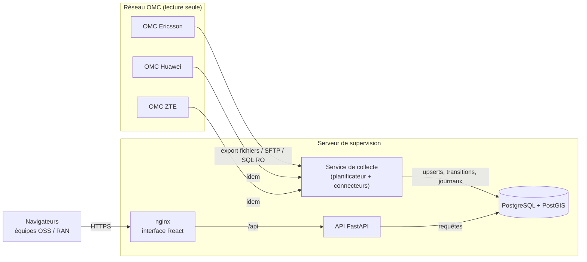
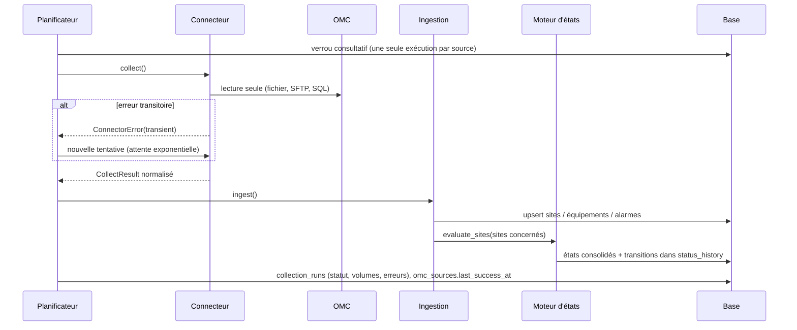

# 1. Architecture

## Vue d'ensemble

| Composant | Technologie | Rôle |
|---|---|---|
| Interface web | React 18, Leaflet 1.9 + markercluster, Recharts, servie par nginx | Carte, fiches site, tableau, tableau de bord, alarmes, administration. Aucun logiciel à installer sur les postes. |
| API | Python 3.13, FastAPI, SQLAlchemy 2, psycopg 3 | Authentification, rôles, filtres, agrégats, exports, administration, audit. |
| Service de collecte | Même code Python, APScheduler ; lit les OMC directement (fichiers, SQL) ou via Prometheus / Alertmanager (docs/10_PROMETHEUS.md) | Une tâche par source OMC, à sa propre fréquence ; réévaluation des états, instantanés, purge. Tourne en arrière-plan, indépendamment de l'interface. |
| Base | PostgreSQL 16 + PostGIS 3 | Inventaire, états, historique, alarmes, collectes, utilisateurs, audit. |

## Choix techniques

- **PostgreSQL/PostGIS** : colonne `geography(Point)` générée à partir de latitude/longitude, index GiST pour les requêtes par emprise (bbox) et le rattachement automatique d'un site à sa wilaya à partir des contours administratifs ; index trigramme pour la recherche par nom ou code ; contraintes d'unicité garantissant l'absence de doublons.
- **Une seule base de code Python** pour l'API et la collecte, mais **deux processus séparés** : une panne ou une lenteur d'OMC ne ralentit jamais l'interface, et un redémarrage de l'API n'interrompt pas la collecte.
- **Leaflet + regroupement de marqueurs** avec rendu canvas : plusieurs dizaines de milliers de sites restent fluides. Les groupes prennent la couleur du pire état qu'ils contiennent et affichent le nombre de sites DOWN.
- **Filtres uniques côté serveur** (`backend/app/filters.py`) partagés par la carte, le tableau, le tableau de bord, les alarmes et les exports : les compteurs sont toujours cohérents avec la carte.
- **Aucune dépendance Internet.** La carte de l'Algérie (contours des 69 wilayas en base PostGIS, pays voisins en fichier statique) est embarquée et s'affiche hors ligne. Le fond OpenStreetMap en ligne est optionnel : en cas d'inaccessibilité, l'interface bascule automatiquement sur la carte embarquée (voir 09_CARTOGRAPHIE.md).

## Flux de collecte

En cas d'échec, la collecte est marquée `FAILED` avec son motif, la source passe en défaut dans le tableau de bord, et **les états des sites ne sont pas modifiés** : ils vieillissent jusqu'au seuil de péremption puis deviennent `UNKNOWN` (jamais `DOWN`).

## Tâches périodiques du service de collecte

| Tâche | Fréquence (paramétrable) | Rôle |
|---|---|---|
| Collecte par source | `omc_sources.poll_interval_s` (30 s à 24 h) | Lecture OMC + ingestion |
| Synchronisation des tâches | 20 s | Prise en compte des sources ajoutées / modifiées / désactivées et des demandes « Synchroniser » |
| Réévaluation des états | `collector.evaluate_every_s` (60 s) | Vieillissement des données, confirmations anti-rebond |
| Instantanés | `collector.snapshot_every_s` (15 min) | Courbes d'évolution du tableau de bord |
| Battement de cœur | 30 s | Détection d'un collecteur arrêté |
| Purge | 24 h | Rétention de l'historique, des collectes, des instantanés |

Filet de sécurité : l'API réévalue elle aussi les états toutes les 90 s. Si le service de collecte est arrêté, les données continuent donc de vieillir (sites → INCONNU) et la carte affiche un bandeau d'alerte. Un verrou PostgreSQL garantit qu'une seule réévaluation s'exécute à la fois et qu'une transition n'est jamais historisée deux fois.

## Sécurité (résumé)

- Authentification obligatoire (jetons JWT signés, durée limitée, révocables), mots de passe bcrypt, verrouillage après échecs, changement imposé au premier login.
- Trois rôles : **Administrateur**, **Superviseur**, **Consultation** ; droit d'export contrôlé et journalisé.
- Journal d'audit des opérations sensibles (connexions, échecs, exports, modifications de configuration, d'utilisateurs, de règles, imports).
- Aucun secret dans le code ni en base : variables d'environnement / fichiers de secrets ; l'API refuse une configuration de source contenant une clé ressemblant à un secret.
- Accès OMC en lecture seule : les connecteurs n'exposent aucune opération d'écriture ; le connecteur SQL n'accepte qu'une requête `SELECT` unique en transaction lecture seule ; le SFTP exige la vérification de la clé d'hôte.
- Validation des entrées (Pydantic), requêtes SQL paramétrées, en-têtes de sécurité (CSP, X-Frame-Options…), base non exposée hors du réseau Docker interne.
- Aucune modification de configuration des équipements réseau n'est possible depuis l'application.
