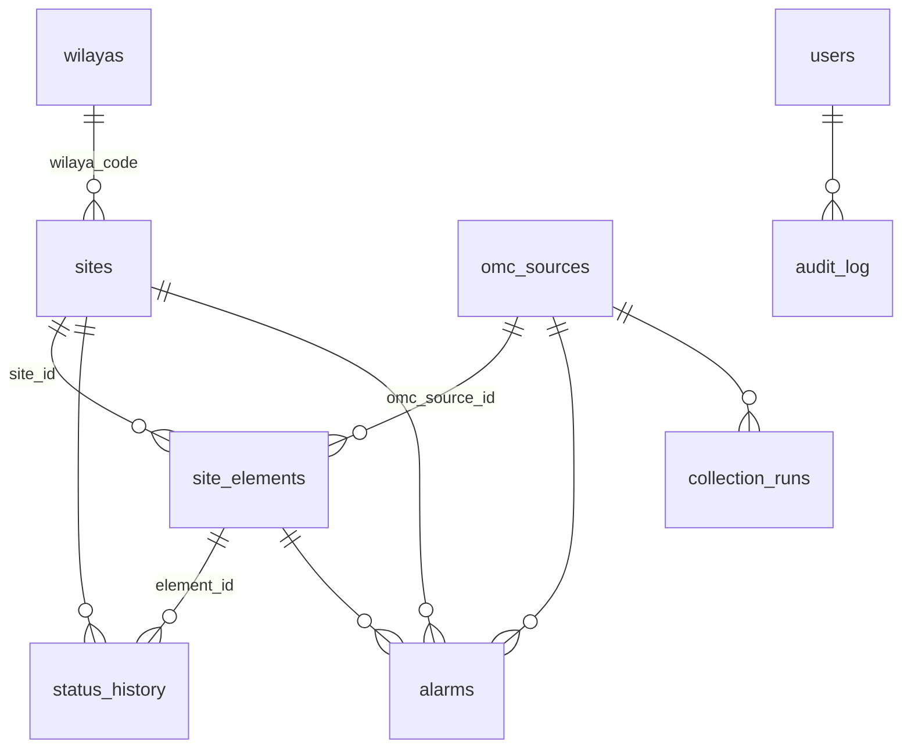

# 2. Modèle de données

Source de vérité : [`db/init/02_schema.sql`](../db/init/02_schema.sql) (PostgreSQL 14+ / PostGIS 3+). Les modèles ORM (`backend/app/models.py`) y sont alignés ; le test `tests/test_schema.py` le vérifie.

## Tables

| Table | Contenu | Clé d'unicité (anti-doublon) |
|---|---|---|
| `wilayas` | Référentiel des **69 wilayas** (code, nom FR/AR, région, chef-lieu, centre, **wilaya mère** et année de création, **contour PostGIS** et son origine `osm-geoalgeria` ou `custom`) | `code` |
| `omc_sources` | Une ligne par serveur OMC : équipementier, type de connecteur, fréquence, seuil de péremption, configuration **non secrète**, dernier essai / succès / erreur, échecs consécutifs, intégration validée ou non | `code` |
| `sites` | Identifiant interne, **code site externe**, nom, équipementier (`MULTI` si plusieurs), wilaya, commune, adresse, latitude/longitude + `geom` générée, technologies (dénormalisées), **état consolidé** + depuis + motif, état en attente de confirmation, dernière observation, indicateur de données périmées, infos OMC complémentaires (`extra`) ; **référentiel** : présent au référentiel, cycle de vie brut + catégorie (`ref_status`), direction régionale (`dr`), technologies du référentiel, date d'import ; **supervision** : remonté par un OMC (`is_supervised`), dernière remontée (`last_supervised_at`) ; origine de la dernière écriture au référentiel (`ref_source` import / manuel, `ref_updated_at`, `ref_updated_by`) | `external_id` |
| `site_elements` | Équipements / technologies d'un site (BTS, NodeB, eNodeB, gNodeB, cellules…) : technologie, état normalisé + **valeur brute**, observé le, dernier changement, dernière communication, source OMC | (`omc_source_id`, `external_id`) |
| `status_history` | **Une ligne par transition** d'état (site ou équipement) : ancien / nouvel état, date du changement, date d'observation, source, motif, alarme associée | — |
| `alarms` | Identifiant OMC, site / équipement, code, description, gravité, début, fin, état ACTIVE/CLEARED | (`omc_source_id`, `external_alarm_id`) |
| `reference_imports` | Historique des imports du référentiel de sites : origine (interface, dossier surveillé, CLI), fichier, empreinte SHA-256, format, mode, statut (appliqué / refusé / échec), correspondance des colonnes, compteurs, messages | — |
| `site_anomalies` | Anomalies de rapprochement référentiel ↔ OMC (site inconnu, démonté actif, en projet actif, supervision perdue, jamais supervisé) : détails, détectée le / vue le / résolue le, prise en compte (qui, quand, commentaire) | une anomalie ouverte par (`anomaly_type`, `site_id`) |
| `site_code_aliases` | Correspondances de codes : code remonté par un OMC → site du référentiel (commentaire, auteur, date) ; appliquées à chaque collecte | `omc_code` |
| `alarm_rules` | Règles de déduction d'état depuis les alarmes, **sans effet tant qu'elles ne sont pas validées** par un administrateur | — |
| `app_settings` | Paramètres (règles d'états, collecte, rétention) | `key` |
| `collection_runs` | Journal de chaque collecte : début, fin, statut, tentatives, volumes traités, rejets, erreur, détails | — |
| `kpi_snapshots` | Compteurs par état, équipementier et wilaya à intervalle régulier (courbes) | (`taken_at`, `vendor`, `wilaya_code`) |
| `service_heartbeats` | Battement de cœur du service de collecte | (`service`, `host`) |
| `users` | Comptes, rôle, droit d'export, verrouillage, version de jeton (révocation) | `username` |
| `audit_log` | Actions sensibles : qui, quoi, cible, détails, IP, date | — |

## Identifiants

- **`sites.external_id`** est le code site opérateur, commun à toutes les technologies d'un site. Si un OMC ne fournit pas ce code directement, le connecteur le dérive du nom d'équipement par expression régulière (configuration `derive.site_id_regex`).
- **`site_elements.external_id`** est l'identifiant de l'équipement **dans son OMC** ; le couple (source, identifiant) est unique, ce qui permet à deux OMC d'utiliser des identifiants identiques sans collision.
- Un site peut regrouper des équipements de plusieurs sources (ex. 2G et 4G gérées par deux OMC) : il est alors marqué `MULTI` s'il y a plusieurs équipementiers.

## Historisation et volumétrie

Les observations sans changement ne créent pas de ligne d'historique (sinon : nombre de sites × fréquence de collecte). La dernière observation est portée par `site_elements.status_observed_at` et `sites.last_observed_at`. Les transitions suffisent à reconstituer exactement les durées de panne et la disponibilité.

Rétention par défaut (paramétrable dans `app_settings.collector`) : historique et alarmes terminées 730 jours, collectes 90 jours, instantanés 400 jours.

## Index principaux

GiST sur `sites.geom` et `wilayas.boundary` ; trigramme sur `sites.name` et `sites.external_id` ; GIN sur `sites.technologies` ; B-tree sur état, wilaya, équipementier ; `status_history (site_id, changed_at DESC)` ; alarmes actives par site (index partiel).

## Évolutions du schéma

Les scripts `db/init/*.sql` sont idempotents (`IF NOT EXISTS`, `ON CONFLICT`) et rejoués à chaque démarrage de l'API (`python -m app.cli init-db`). Pour une évolution : ajouter un script numéroté (`04_…sql`) idempotent, incrémenter `schema_version`, adapter `models.py` ; `tests/test_schema.py` signale tout écart.
