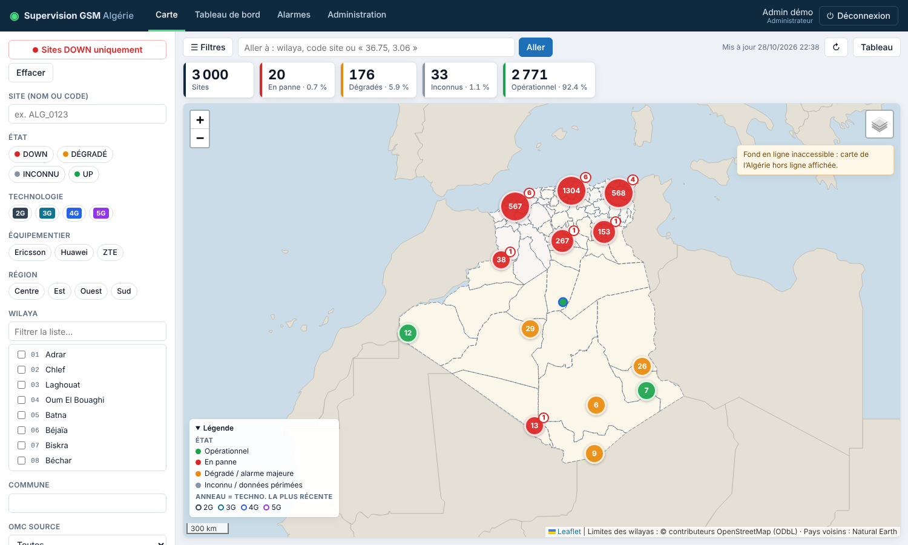
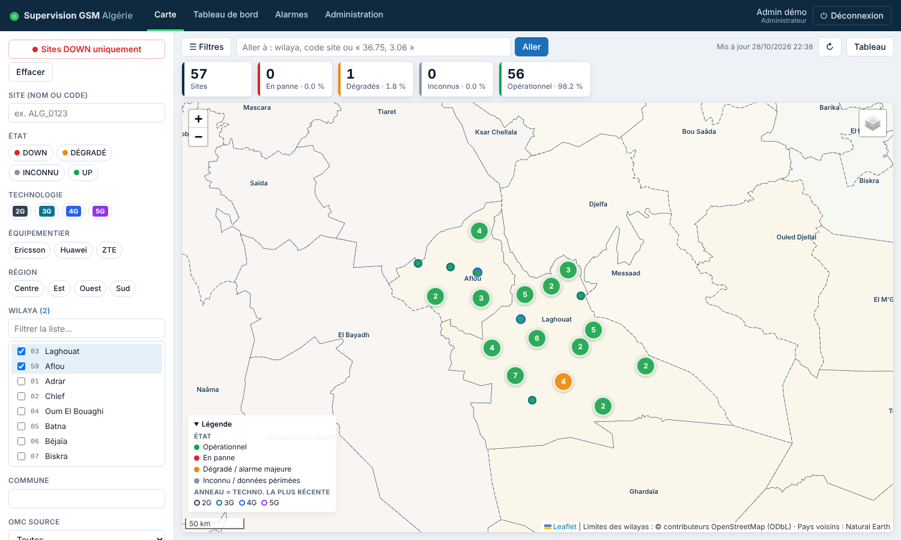
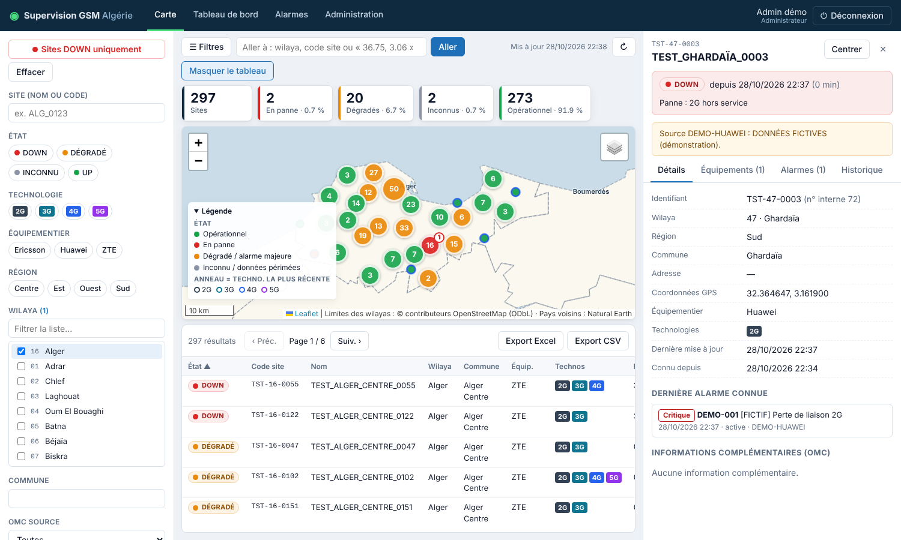
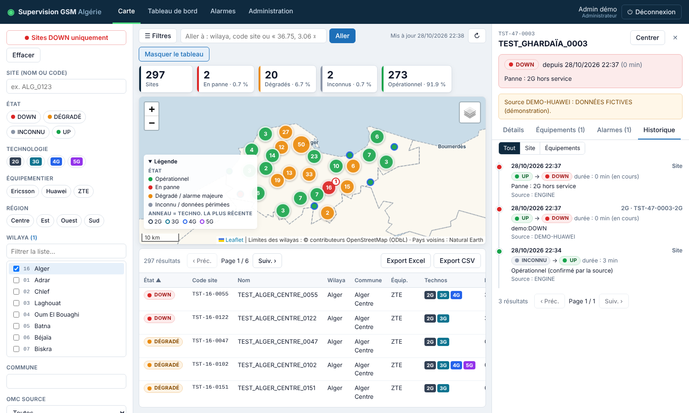
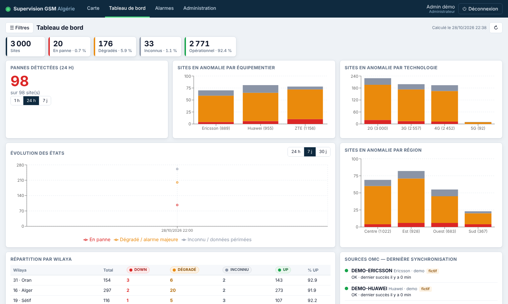
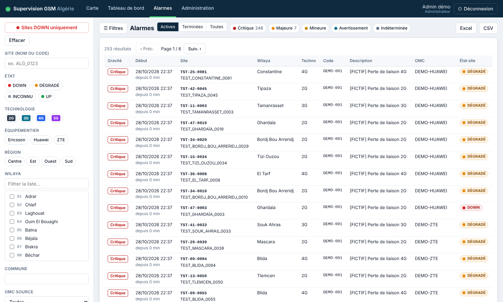
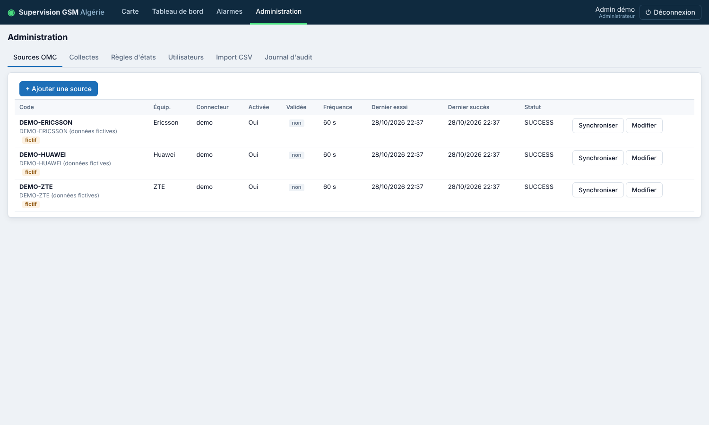
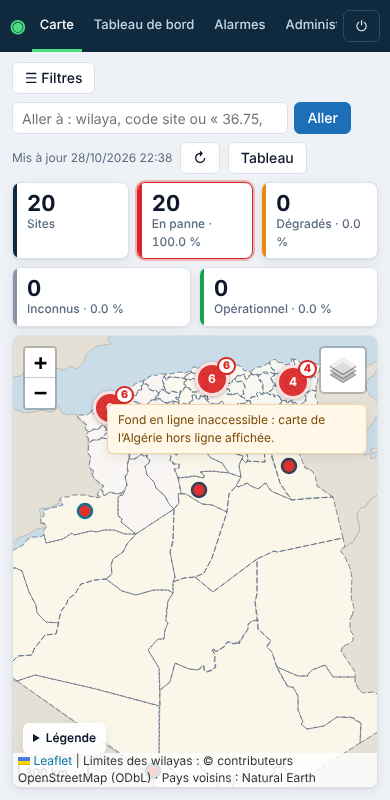

# 6. Guide utilisateur

> Les captures ont été réalisées avec le jeu de données **fictif** et la carte de l'Algérie embarquée (fond hors ligne).

## Connexion

Ouvrir l'adresse communiquée par l'administrateur dans un navigateur récent (Chrome, Edge, Firefox). Saisir l'identifiant et le mot de passe. À la première connexion, un nouveau mot de passe est demandé (10 caractères minimum, au moins 3 types parmi minuscules, majuscules, chiffres, symboles). Après plusieurs échecs, le compte est verrouillé temporairement. La session expire au bout d'une heure (paramétrable) : il suffit de se reconnecter.

## Rôles

| Rôle | Peut |
|---|---|
| Consultation | Voir la carte, les fiches, le tableau de bord, les alarmes ; exporter si l'administrateur l'a autorisé |
| Superviseur | + exporter, lancer une synchronisation immédiate d'un OMC, consulter le journal des collectes |
| Administrateur | + gérer les sources OMC, les règles d'états, les utilisateurs, l'import CSV, consulter l'audit |

## Carte

- **Chaque site est un pylône en 3D** dont la **couleur = état** : vert UP, rouge DOWN (avec halo au sol), orange dégradé ou alarme majeure, gris inconnu. La balise au sommet reprend l'état. Un pylône pâle signale des données périmées. Le pylône grandit avec le zoom.
- **Petit pylône blanc-gris = site non supervisé** : site du référentiel qu'aucun OMC ne remonte (ce n'est ni une panne ni un état inconnu). Voir [11_REFERENTIEL.md](11_REFERENTIEL.md).
- **Antennes = technologies du site** (une couleur par technologie, jusqu'à trois panneaux : 2G gris foncé, 3G cyan, 4G bleu, 5G violet).
- **Groupes** : à petite échelle, les sites proches sont regroupés. Le groupe prend la couleur du **pire état** qu'il contient et affiche en pastille le **nombre de sites DOWN**. Cliquer pour zoomer.
- **Bandeau de compteurs** : nombre de sites par état selon les filtres en cours ; cliquer un compteur filtre la carte sur cet état.
- **Aller à** : nom de wilaya, code ou nom de site, ou coordonnées « 36.75, 3.06 ».
- **Fond de carte** (icône en haut à droite) : « Plan OpenStreetMap » (nécessite Internet) ou « Algérie (hors ligne) » : 69 wilayas, mer et pays voisins, toujours disponible. Sans accès Internet, la carte bascule seule sur le fond hors ligne. Le choix est mémorisé sur le poste.
- **Couches** : limites et noms des 69 wilayas (les noms apparaissent en zoomant).

- La carte se met à jour automatiquement toutes les minutes ; ↻ force la mise à jour.
- Un bandeau orange signale une source OMC en échec ou en retard : les états de ses sites peuvent être obsolètes.

## Filtres

Panneau de gauche (bouton **☰ Filtres** pour l'afficher / le masquer). Les filtres se combinent et s'appliquent à la carte, au tableau, au tableau de bord, aux alarmes et aux exports ; ils sont conservés dans l'adresse de la page (lien partageable).

- **Sites DOWN uniquement** : filtre rapide.
- Site (nom ou code), état (dont « non supervisé »), technologie, équipementier, région, wilaya (liste à cocher avec recherche), commune, OMC source.
- **Référentiel** : par défaut, sites en service, arrêts temporaires et tout site remonté par un OMC ; au choix tous les sites (y compris en projet et démontés), une catégorie, ou les sites hors référentiel.
- **Direction régionale** (si le référentiel en contient).
- **Panne détectée entre** : sites ayant eu un passage à DOWN sur la période.
- **Données périmées uniquement**.
- **Effacer** : retire tous les filtres.

## Tableau des sites

Bouton **Tableau** : liste paginée des sites filtrés, triable par colonne. **Un clic sur une ligne centre la carte sur le site et ouvre sa fiche.** Boutons **Export Excel / Export CSV** (si autorisé) : exportent l'ensemble des résultats filtrés.

## Fiche d'un site

Ouverte par un clic sur un marqueur ou une ligne : état actuel et depuis quand, motif, avertissements (données périmées, OMC en défaut, données fictives).
- **Détails** : identifiant, wilaya, région, commune, coordonnées GPS, équipementier, technologies, dernière mise à jour, dernière alarme connue, informations complémentaires OMC.
- **Équipements** : état de chaque technologie / équipement, valeur brute reçue de l'OMC, horodatages, source.
- **Alarmes** : alarmes actives par gravité.
- **Historique** : chaque changement d'état (site ou équipement) avec date, durée et motif.

## Tableau de bord

Compteurs par état, pannes détectées sur 1 h / 24 h / 7 j, sites en anomalie par équipementier, technologie et région, évolution des états dans le temps, répartition par wilaya (clic → carte filtrée), dernière synchronisation de chaque OMC et état du service de collecte, dernières pannes avec leur durée (export possible), disponibilité par wilaya / équipementier / région / site.

## Alarmes

Liste des alarmes actives, terminées ou toutes, filtrables par gravité et par les filtres de sites ; clic → fiche du site ; export Excel / CSV.

## Référentiel des sites

Menu **Référentiel** (badge orange = anomalies à traiter) : synthèse, **gestion des sites** (rechercher, ajouter, modifier, retirer, supprimer, en lot), **sites inconnus remontés par les OMC** (rattacher au bon site, ajouter au référentiel, ignorer), anomalies de rapprochement avec les OMC (sites inconnus du référentiel, démontés encore actifs, en projet déjà en service, supervision perdue), import d'un fichier KMZ / Excel / CSV avec prévisualisation, historique des imports, paramètres. Détails : [11_REFERENTIEL.md](11_REFERENTIEL.md).

## Administration

- **Sources OMC** : état de chaque source, dernière collecte, bouton **Synchroniser**, ajout / modification (administrateur).
- **Collectes** : journal détaillé (durée, tentatives, volumes, lignes rejetées, erreurs).
- **Règles d'états** : seuils de péremption, délais de confirmation, règles d'alarmes (à valider explicitement).
- **Utilisateurs** : création, rôle, droit d'export, activation, réinitialisation du mot de passe.
- **Import CSV** : chargement d'un fichier de sites (format décrit à l'écran).
- **Journal d'audit** : connexions, exports, modifications.

## Sur téléphone ou tablette

L'interface s'adapte aux petits écrans : filtres en panneau superposé, fiche du site en volet bas.

