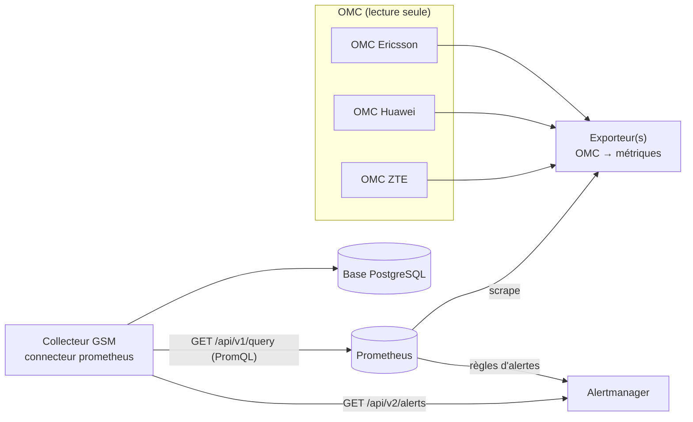
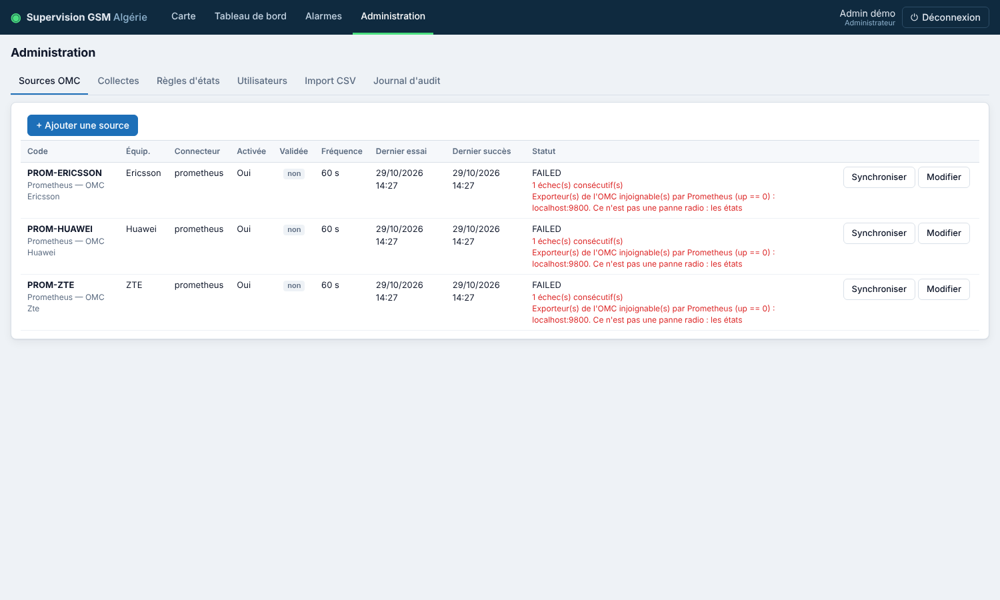

# 10. Intégration Prometheus

Le connecteur `prometheus` récupère l'état des équipements radio et les alarmes actives depuis **Prometheus** (et, en option, **Alertmanager**). Il a été testé avec Prometheus 3.11.0 et Alertmanager 0.31.1 réels, alimentés par l'exporteur de démonstration fourni.

## Architecture



**Point essentiel : Prometheus ne se connecte pas lui-même aux OMC.** Il lit (« scrape ») des **exporteurs** : de petits services qui interrogent l'OMC en lecture seule et publient des métriques au format Prometheus. Prometheus ne fait donc que transporter et historiser les données, et la qualité de la supervision dépend de l'exporteur choisi pour chaque OMC.

| Interface disponible sur l'OMC | Exporteur possible |
|---|---|
| SNMP (table d'état des NE, MIB de l'équipementier) | `snmp_exporter` (projet Prometheus), configuré à partir des **MIB réelles** de l'équipementier. Les traps SNMP (alarmes poussées) ne sont pas traités par `snmp_exporter` : récepteur fourni, voir [13_ALARMES_SNMP.md](13_ALARMES_SNMP.md). |
| API REST / JSON (interface nord) | `json_exporter` (prometheus-community), ou un exporteur dédié |
| Base de données en lecture seule | Exporteur SQL de la communauté (requêtes validées par l'exploitant) |
| Fichiers d'export (CSV…) | Exporteur fourni : script + collecteur « textfile » de `node_exporter` ([12_EXPORTEUR_FICHIERS.md](12_EXPORTEUR_FICHIERS.md)). *Si Prometheus n'apporte rien d'autre, le connecteur `file_export` de l'application lit ces fichiers directement.* |

Le choix dépend des interfaces réellement licenciées et activées sur chaque OMC (voir [08_INFORMATIONS_A_FOURNIR.md](08_INFORMATIONS_A_FOURNIR.md)). Aucun format propre à un équipementier n'est supposé ici.

## Contrat de métriques (configuration par défaut)

Si les exporteurs publient ces métriques, une source n'a besoin que de l'URL de Prometheus. Sinon, tout est paramétrable (voir plus bas).

| Métrique | Labels | Valeur |
|---|---|---|
| `gsm_ne_oper_status` | `site_id`, `ne_id`, `technology` (+ `vendor`) | `1` en service, `0` hors service, `2` dégradé |
| `gsm_ne_info` *(optionnelle)* | `site_id`, `site_name`, `ne_id`, `ne_name`, `ne_type`, `technology`, `latitude`, `longitude`, `wilaya_code`, `commune` | `1` |
| `gsm_ne_active_alarm` *(optionnelle)* | `alarm_id`, `site_id`, `ne_id`, `code`, `severity`, `description` | début de l'alarme (horodatage Unix) |
| `up` (automatique) | `job="gsm-omc-<…>"`, `vendor` | `1` si l'exporteur répond |

- `vendor` (`ericsson`, `huawei`, `zte`) est ajouté par Prometheus aux cibles de chaque OMC ([`deploy/prometheus/prometheus.yml`](../deploy/prometheus/prometheus.yml)). Les requêtes du connecteur filtrent dessus : une même instance Prometheus peut servir les trois équipementiers.
- `technology` accepte `2G/3G/4G/5G` ou `GSM/UMTS/LTE/NR`.
- `site_id` est le code site opérateur commun aux technologies. S'il n'existe pas, il peut être extrait de `ne_id` par expression régulière (`derive.site_id_regex`).
- Les coordonnées (`gsm_ne_info`) sont facultatives : un référentiel de sites importé par CSV (Administration › Import CSV) fournit noms et positions, que Prometheus n'écrase jamais.

Implémentation de référence : [`tools/demo_exporter/demo_exporter.py`](../tools/demo_exporter/demo_exporter.py) (données **fictives**, bibliothèque standard Python).

## Déclarer une source Prometheus

**Administration › Sources OMC › Ajouter une source**, connecteur « Prometheus / Alertmanager ». Créer **une source par équipementier** (ex. `PROM-HUAWEI`, `PROM-ERICSSON`, `PROM-ZTE`).

Configuration minimale :

```json
{ "url": "http://prometheus:9090",
  "alarms": { "source": "alertmanager", "url": "http://alertmanager:9093" } }
```

| Réglage | Valeur conseillée |
|---|---|
| Fréquence de collecte | 60 à 300 s (≥ intervalle de scrape de Prometheus) |
| Données périmées après | fréquence + 300 s + marge, ex. **900 s** pour 60 s (Prometheus ne renvoie que les échantillons de moins de 5 min) |

Exemple de configuration complète, pour des métriques qui ne suivent pas le contrat :

```json
{
  "url": "https://prometheus.intranet:9090",
  "ca_file": "/app/config/ca-interne.pem",
  "health_query": "up{job=\"omc-ericsson-snmp\"}",
  "info": { "query": null },
  "status": { "query": "omc_ne_connection_state{omc=\"ENM-1\"}", "from": "label", "label": "state" },
  "labels": { "element_id": "ne", "site_id": null, "technology": "rat" },
  "derive": { "site_id_regex": "^(?P<site>[A-Z]{3}\\d{4})" },
  "value_maps": { "status": { "connected": "UP", "disconnected": "DOWN" } },
  "alarms": { "source": "promql", "query": "omc_active_alarm{omc=\"ENM-1\"}",
              "labels": { "alarm_id": "id", "element_id": "ne", "code": "code",
                          "severity": "severity", "description": "text" } }
}
```

Tous les paramètres et leurs valeurs par défaut : [`backend/app/collector/profiles/prometheus.yaml`](../backend/app/collector/profiles/prometheus.yaml). `${vendor}` dans une requête est remplacé par l'équipementier de la source.

**Alarmes**, deux modes :
- `alertmanager` : alertes actives lues par l'API v2 (filtre `vendor="…"` par défaut ; les alertes silencées sont ignorées). Identifiant = label `alarm_id`, sinon l'empreinte stable de l'alerte. Description = annotation `summary`.
- `promql` : une série par alarme active (ex. `gsm_ne_active_alarm`), valeur = début de l'alarme.

Dans les deux cas, l'ensemble lu est considéré comme **complet** : une alarme qui disparaît est marquée terminée. Exemples de règles : [`deploy/prometheus/rules/gsm.rules.yml`](../deploy/prometheus/rules/gsm.rules.yml).

**Authentification** (si Prometheus ou Alertmanager sont protégés), dans `.env.omc` :

```
OMC_PROM_HUAWEI_USERNAME=lecture
OMC_PROM_HUAWEI_PASSWORD=…
# ou : OMC_PROM_HUAWEI_BEARER_TOKEN=…
```

## Fiabilité : perte de collecte ≠ panne radio

| Situation | Résultat dans l'application |
|---|---|
| Prometheus ou Alertmanager injoignable, délai dépassé | Collecte **ÉCHEC**, nouvelles tentatives ; états inchangés puis INCONNU après le délai de péremption |
| Exporteur de l'OMC arrêté (`up == 0` sur toutes les cibles) | Collecte **ÉCHEC** : « Ce n'est pas une panne radio » |
| Une partie des cibles en échec | Collecte réussie avec avertissement ; seuls les équipements des cibles actives sont mis à jour |
| Aucune série d'état renvoyée | Collecte **ÉCHEC** (exporteur arrêté ou requête incorrecte) |
| Requête PromQL invalide, accès refusé (401/403) | **ÉCHEC** sans nouvelle tentative, message explicite |
| Valeur `NaN` ou non prévue dans `value_maps` | État INCONNU pour cet équipement, avertissement dans le journal |
| Équipement absent d'une collecte | Conservé ; son état vieillit jusqu'à INCONNU (jamais supprimé ni mis DOWN) |

Scénario vérifié sur la pile réelle : exporteur arrêté → Prometheus voit `up == 0` → les trois sources passent en ÉCHEC (4 tentatives) → aucune transition DOWN créée → exporteur relancé → retour automatique au succès.



Le connecteur n'émet que des requêtes de lecture (`GET /api/v1/query`, `GET /api/v2/alerts`). Prometheus et Alertmanager ne peuvent rien modifier sur les OMC.

## Mise en place

**Prometheus existant** : déclarer les sources avec son URL, et vérifier que le service de collecte peut le joindre (réseau `omc`).

**Nouvelle pile** (fichier fourni) :

```bash
# Ajuster deploy/prometheus/prometheus.yml : vos exporteurs à la place de demo-exporter
docker compose -f docker-compose.yml -f docker-compose.prometheus.yml up -d
# Démonstration complète avec données FICTIVES :
docker compose -f docker-compose.yml -f docker-compose.prometheus.yml --profile demo up -d
```

**Tester une source sans rien écrire en base** :

```bash
docker compose exec collector python -m app.cli test-source PROM-HUAWEI
```

## Accès web à Prometheus et Alertmanager

Prometheus et Alertmanager n'ont **aucune authentification** par défaut. Ils sont donc publiés derrière le nginx de l'application, sur le même port, avec un mot de passe :

| Outil | Adresse |
|---|---|
| Prometheus | `http://<serveur>:8080/prometheus/` |
| Alertmanager | `http://<serveur>:8080/alertmanager/` |

Les deux liens figurent aussi dans **Administration › Sources OMC** dès qu'une source Prometheus existe.

```bash
# 1. Adresse utilisée par les navigateurs (liens générés par Prometheus et Alertmanager)
sed -i 's#^PUBLIC_URL=.*#PUBLIC_URL=http://192.168.100.102:8080#' .env
# 2. Compte d'accès (12 caractères minimum ; relancer la commande pour changer le mot de passe)
./scripts/prometheus_password.sh supervision
# 3. Démarrage ou prise en compte
docker compose -f docker-compose.yml -f docker-compose.prometheus.yml up -d
```

- Sans compte créé, l'accès est refusé (fermé par défaut). Les comptes sont pris en compte sans redémarrage. Suppression : `./scripts/prometheus_password.sh --supprimer <utilisateur>`.
- Ces comptes sont **distincts** de ceux de l'application : à réserver aux administrateurs.
- **Silences Alertmanager** : une alerte mise en silence n'est plus lue par l'application (`include_silenced: false`), donc l'alarme correspondante y apparaît terminée. À utiliser en connaissance de cause.
- Si la pile Prometheus n'est pas démarrée, ces adresses affichent « Prometheus / Alertmanager non démarré ».
- **Accès depuis Internet** : ne pas publier en HTTP. Activer HTTPS sur nginx (bloc `443` de `deploy/nginx/gsm.conf`, certificat de l'entreprise) ou passer par le VPN ; sinon le mot de passe circule en clair.
- L'interface d'origine reste disponible sur le serveur lui-même : `http://127.0.0.1:9090` (Prometheus). Le collecteur, lui, interroge Prometheus directement sur le réseau Docker interne, sans passer par ce mot de passe.

## Validation sur données réelles (par OMC)

1. L'exporteur répond (`up == 1`) et publie des séries pour tous les équipements attendus : comparer `count(gsm_ne_oper_status{vendor="…"})` à l'inventaire de référence de l'OMC.
2. Les valeurs d'état correspondent à la console OMC : 10 équipements en service et tous ceux hors service au moment du test.
3. Arrêter l'exporteur quelques minutes : la source passe en ÉCHEC, aucune bascule DOWN ; retour à la normale ensuite.
4. Un équipement mis hors service en maintenance apparaît DOWN, puis UP à son retour, dans l'historique.
5. Les alarmes actives correspondent à la console ; leur fin est reflétée.
6. Consigner les résultats, puis cocher « Intégration validée » pour la source.

## Tests automatisés

`backend/tests/test_prometheus.py` : contrat et filtrage par équipementier, état par valeur ou par label, extraction du code site, `NaN`, exporteur arrêté, cibles partielles, absence de séries, erreurs PromQL, 401, Prometheus injoignable, alarmes Alertmanager (empreinte, filtres, authentification) et PromQL, préservation du référentiel. Le test d'intégration s'exécute contre un vrai Prometheus si `PROMETHEUS_TEST_URL` (et `ALERTMANAGER_TEST_URL`) sont définis :

```bash
python3 tools/demo_exporter/demo_exporter.py --port 9800 &        # + Prometheus et Alertmanager configurés
PROMETHEUS_TEST_URL=http://127.0.0.1:9090 ALERTMANAGER_TEST_URL=http://127.0.0.1:9093 \
TEST_DATABASE_URL=postgresql+psycopg://postgres@localhost:5432/postgres pytest tests/test_prometheus.py
```
